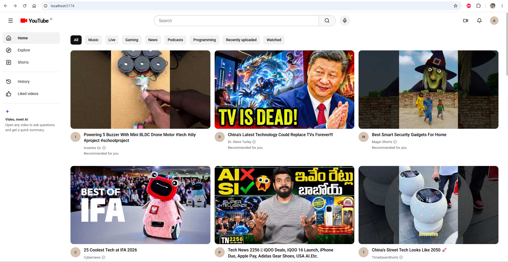
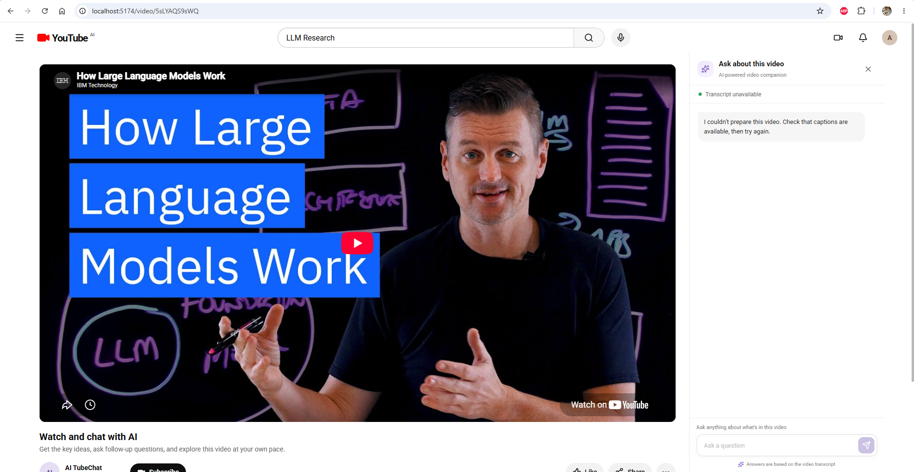

# YouTube AI Chat

YouTube AI Chat lets you find a YouTube video, watch it, and ask questions about its transcript. The React app displays the video and chat; a FastAPI service fetches captions, indexes transcript passages in ChromaDB, finds relevant passages for each question, and asks Gemini to answer from that context.

## Demo

These illustrative screenshots show the main screens and an example conversation. The video titles and assistant reply are sample content; a live run uses the selected video's transcript and configured services.

### Browse videos



### Ask the video assistant



## How it works

1. Search for a video in the home page and open it.
2. The frontend sends its YouTube video ID to `POST /api/process-video`.
3. The backend fetches the video's captions, splits the transcript into overlapping passages, creates embeddings, and saves them in a video-specific ChromaDB collection.
4. A question is sent to `POST /api/chat`. The backend retrieves the four most relevant passages and gives them with the question to Gemini.
5. The assistant reply appears in the chat. Its prompt directs it to answer from the transcript and say when the context is insufficient.

## Requirements

- Python 3.10 or newer
- Node.js and npm
- A YouTube Data API key for searching videos
- A Google Gemini API key for generating answers
- Internet access to fetch YouTube captions and download the embedding model on first use

## Run locally

### 1. Configure the backend

In a terminal, from the repository root:

```powershell
cd backend
python -m venv .venv
\.venv\Scripts\Activate.ps1
pip install -r requirements.txt
Copy-Item .env.example .env
```

Open `backend/.env` locally and set `GOOGLE_API_KEY` to your own Gemini key. Do not commit `.env` or paste real keys into documentation.

Start the API:

```powershell
uvicorn main:app --reload --host 127.0.0.1 --port 8000
```

The API health endpoint is at `http://127.0.0.1:8000/health`; interactive API docs are at `http://127.0.0.1:8000/docs`.

### 2. Configure the frontend

In a second terminal, from the repository root:

```powershell
cd frontend
npm install
```

Create `frontend/.env.local` with your local settings (replace the placeholders on your machine):

```dotenv
VITE_YOUTUBE_API_KEY=your_youtube_data_api_key
VITE_BACKEND_URL=http://127.0.0.1:8000
```

Start the app:

```powershell
npm run dev
```

Open the local URL printed by Vite. `VITE_YOUTUBE_API_KEY` is used by the browser for YouTube search, so it is exposed in the frontend bundle; restrict that key to the YouTube Data API and your development/deployment referrers in Google Cloud. Keep the Gemini key on the backend only.

## API overview

| Endpoint | Purpose | Example request |
| --- | --- | --- |
| `GET /health` | Check that the API is running | — |
| `POST /api/process-video` | Fetch and index a video's transcript | `{"video_id":"YOUTUBE_VIDEO_ID"}` |
| `POST /api/chat` | Ask a question about an indexed video | `{"video_id":"YOUTUBE_VIDEO_ID","query":"What are the key points?"}` |

## Project layout

```text
backend/       FastAPI endpoints, transcript processing, embeddings, and chat retrieval
frontend/      React + TypeScript + Vite user interface
docs/images/   Illustrative application screenshots used in this README
```

## Notes

- The video needs accessible captions for transcript indexing.
- ChromaDB data is stored in `backend/chroma_db` by default (relative to the backend working directory).
- The frontend calls YouTube Data API directly; provide its key only through local frontend environment configuration.
- Assistant answers depend on the indexed transcript and the configured Gemini service.
